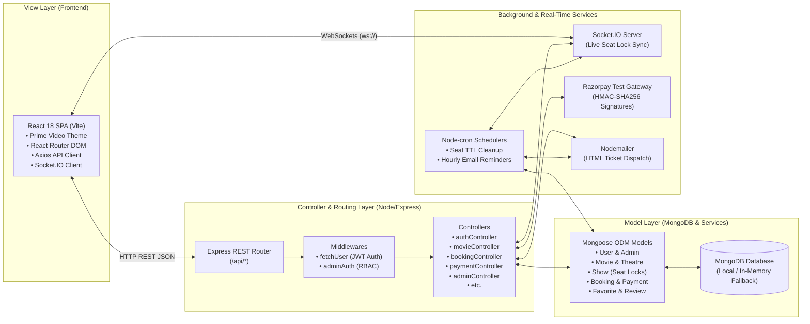
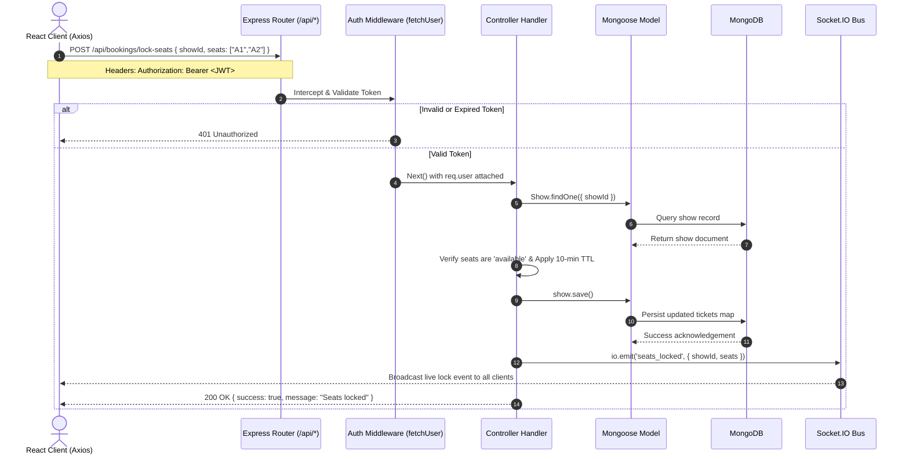

# 🏛️ iMovies - System Architecture & MVC Pattern Implementation

This document provides a comprehensive architectural specification for the **iMovies - Movie Ticket Booking Platform**. It describes the application of the **Model-View-Controller (MVC)** architectural design pattern within a decoupled client-server web application.

---

## 1. Architectural Overview

iMovies is built using a modern **Client-Server Architecture** that adheres strictly to the separation of concerns governed by the **Model-View-Controller (MVC)** design pattern.



---

## 2. The Model Layer (Data & State Management)

The **Model Layer** encapsulates the application's domain logic, data persistence rules, validation constraints, and database relationships using **Mongoose ODM** on top of **MongoDB**.

### 2.1 Domain Schemas (`server/models/`)

| Model | File | Primary Responsibility |
| :--- | :--- | :--- |
| **User** | [`userModel.js`](file:///C:/Users/Riddhika%20Verma/.gemini/antigravity/scratch/iMovies/server/models/userModel.js) | Stores customer credentials (bcrypt-hashed passwords), email uniqueness, and contact details. |
| **Admin** | [`adminModel.js`](file:///C:/Users/Riddhika%20Verma/.gemini/antigravity/scratch/iMovies/server/models/adminModel.js) | Administrator accounts with elevated privileges for managing cinema listings, revenue stats, and refunds. |
| **Movie** | [`movieModel.js`](file:///C:/Users/Riddhika%20Verma/.gemini/antigravity/scratch/iMovies/server/models/movieModel.js) | Cinema releases with genre arrays, certificate ratings, HD posters/backdrops, trailers, runtime, and cast. |
| **Theatre** | [`theatreModel.js`](file:///C:/Users/Riddhika%20Verma/.gemini/antigravity/scratch/iMovies/server/models/theatreModel.js) | Physical cinema complexes, locations, and tiered row/seat pricing (Balcony, Middle, Lower). |
| **Show** | [`showModel.js`](file:///C:/Users/Riddhika%20Verma/.gemini/antigravity/scratch/iMovies/server/models/showModel.js) | Schedules linking movies to theatres on specific dates/times, managing real-time seat lock state. |
| **Booking** | [`bookingModel.js`](file:///C:/Users/Riddhika%20Verma/.gemini/antigravity/scratch/iMovies/server/models/bookingModel.js) | Reservation ledger tracking seat codes, monetary totals, customer emails, and payment statuses. |
| **Payment** | [`paymentModel.js`](file:///C:/Users/Riddhika%20Verma/.gemini/antigravity/scratch/iMovies/server/models/paymentModel.js) | Gateway transaction log storing Razorpay order IDs, payment IDs, HMAC signatures, and refund details. |
| **Favorite** | [`favoriteModel.js`](file:///C:/Users/Riddhika%20Verma/.gemini/antigravity/scratch/iMovies/server/models/favoriteModel.js) | User watchlists with compound unique indexing (`{ userEmail: 1, movieId: 1 }`). |
| **Review** | [`reviewModel.js`](file:///C:/Users/Riddhika%20Verma/.gemini/antigravity/scratch/iMovies/server/models/reviewModel.js) | User ratings (1-10) and qualitative reviews attached to movies. |

### 2.2 Concurrency & Real-Time Seat Locking Mechanism (TTL)
The `Show` model maintains a dynamic JSON map in the `tickets` field where each seat key (e.g., `"A1"`, `"D5"`) stores its state:
```json
{
  "status": "locked",
  "tier": "balcony",
  "price": 450,
  "lockedBy": "user@imovies.com",
  "lockExpiresAt": "2026-11-04T06:15:00.000Z"
}
```
- **10-Minute Lock TTL**: When a customer selects seats, the status switches from `"available"` to `"locked"`.
- **Automatic Expiration Sweep**: `cleanupService.js` runs every minute via `node-cron`. If `Date.now() > lockExpiresAt` and the payment is not marked `"Completed"`, the seat reverts to `"available"`, and a Socket.IO event informs all active viewers.

### 2.3 Zero-Setup In-Memory MongoDB Fallback
To ensure maximum developer velocity and zero-dependency onboarding, [`server.js`](file:///C:/Users/Riddhika%20Verma/.gemini/antigravity/scratch/iMovies/server/server.js) attempts to connect to `process.env.MONGO_URI`. If an active MongoDB daemon is not detected (`ECONNREFUSED`), it dynamically instantiates an isolated **`MongoMemoryServer`** (MongoDB 7.0.24) and automatically runs the database seed suite (`seedData.js`).

---

## 3. The View Layer (Client SPA & API View Envelopes)

In this decoupled architecture, the View Layer operates at two distinct levels:
1. **Frontend Presentation Views** (React Single Page Application)
2. **REST API View Envelopes** (Standardized JSON payloads dispatched to clients)

### 3.1 Frontend Presentation Views (`client/src/`)
Built with **React 18** and **Vite**, featuring route-level code splitting using `React.lazy()` and `Suspense`:

- **Design System**: Amazon Prime Video dark aesthetic featuring:
  - Deep midnight navy base background (`#0A0E17` / `#0F172A`)
  - Electric cyan / Prime blue accents (`#00A8E1`)
  - Translucent slate-blue containers (`#131B2E`)
  - Crisp high-contrast typography
- **Public Views**:
  - `Landing.jsx`: Billboard hero section and feature discovery.
  - `Login.jsx` & `Register.jsx`: Translucent slate authentication cards with 1-click demo login toggles.
- **User Protected Views (`UserProtection.jsx`)**:
  - `Home.jsx`: Spotlight banner, Prime Video horizontal category rails, responsive 5-column grid, search, and infinite scroll pagination.
  - `MovieDetails.jsx`: Movie synopsis, cast roster, trailer modal, and user reviews.
  - `MovieShows.jsx`: Date ribbon (`dayjs`) and cinema screening format chips.
  - `SeatSlug.jsx`: Interactive real-time seat picker with tier colors and countdown timer.
  - `Bookings.jsx`: Digital boarding pass tickets, celebratory confetti, and 1-click WhatsApp sharing.
  - `FavoriteShows.jsx` & `Profile.jsx`: User watchlist and account profile management.
- **Admin Protected Views (`AdminProtection.jsx`)**:
  - `AdminDashboard.jsx`: Metric cards (gross & net revenue, active bookings) and catalog controls.
  - `AdminTransactions.jsx` & `AdminBookings.jsx`: Transaction ledger and 1-click Razorpay refund engine.
  - `AddMovie.jsx`, `AddTheatre.jsx`, `AddShow.jsx`, `AddAdmin.jsx`: Cinema catalog authoring forms.

### 3.2 REST API View Envelopes (JSON Format)
All controllers format responses through standard response envelopes to guarantee predictability across client consumption:

**Success Response Envelope**:
```json
{
  "success": true,
  "count": 26,
  "total": 26,
  "page": 1,
  "hasMore": false,
  "movies": [ ... ]
}
```

**Error Response Envelope**:
```json
{
  "success": false,
  "message": "Specific human-readable failure reason",
  "error": "Detailed validation or system error"
}
```

---

## 4. The Controller Layer (Application Logic & Orchestration)

Controllers act as the intermediaries between incoming client requests, business rule validation, database operations, and external services.

### 4.1 Controllers Directory (`server/controllers/`)

- **`authController.js`**:
  - Handles customer registration, admin registration, password hashing via `bcryptjs`, and JWT token issuance with 7-day expiration.
- **`movieController.js`**:
  - Handles catalog querying with multi-field search (`movieName`, `director`, `cast`), category sorting, genre/language filtering, pagination (`page`, `limit`), curated Prime Video section rails (`getCuratedSections`), and TMDB multi-page synchronization (`syncTMDBMovies`).
- **`theatreController.js`**:
  - CRUD operations for cinema complexes and tiered seat configurations.
- **`showController.js`**:
  - Show scheduling, grouped theatre queries by movie ID, and showtime validations.
- **`bookingController.js`**:
  - 10-minute temporary seat locking (`lockSeats`), seat unlocking (`unlockSeats`), booking creation, booking cancellation, and user reservation history.
- **`paymentController.js`**:
  - Razorpay order creation (`/create-order`), cryptographic HMAC-SHA256 signature verification (`/verify`), and automated ticket confirmation dispatch.
- **`adminController.js`**:
  - Aggregate analytics calculation (gross revenue, net revenue, total bookings, active users), transaction ledgers, and processing gateway refunds (`/refund/:paymentId`) which automatically frees locked seats.
- **`favoriteController.js` & `reviewController.js`**:
  - Bookmark toggling and customer review submissions.

### 4.2 Middleware Layer (`server/middlewares/`)

- **`fetchUser.js`**:
  - Extracts the `Bearer <token>` from the HTTP `Authorization` header.
  - Verifies token authenticity using `jwt.verify(token, JWT_SECRET)`.
  - Attaches the authenticated user payload (`req.user = { id, email, role }`) to the request object.
- **`adminAuth.js`**:
  - Extends authentication by asserting that `req.user.role === 'admin'`.
  - Rejects unauthorized requests with HTTP `403 Forbidden`.

---

## 5. End-to-End Request Lifecycle



---

## 6. Real-Time & Asynchronous Subsystems

### 6.1 Socket.IO Real-Time Bus
The server registers dedicated room subscriptions (`join_show`, `leave_show`) for show-specific channels:
- `seats_locked`: Broadcasts when a user begins checkout on specific seat IDs.
- `seats_released`: Broadcasts when a user deselects seats or a refund is issued.
- `seats_booked`: Broadcasts upon successful Razorpay payment verification.
- `seats_auto_released`: Broadcasts when the background cron cleanup frees expired locks.

### 6.2 Razorpay 5-Step Transaction Protocol
1. **User Locks Seats**: Client requests `/api/bookings/lock-seats`.
2. **Order Generated**: Backend invokes Razorpay API to generate an `order_id` in paise.
3. **Modal Checkout**: Client completes checkout using UPI, NetBanking, or Cards.
4. **Signature Verification**:
   ```javascript
   const expectedSignature = crypto
     .createHmac('sha256', process.env.RAZORPAY_KEY_SECRET)
     .update(`${razorpay_order_id}|${razorpay_payment_id}`)
     .digest('hex');
   ```
5. **Confirmation & Delivery**: Booking status marked `"Completed"`, seats marked `"booked"`, and digital tickets delivered via email and WhatsApp.

### 6.3 Automated Cron Services (`node-cron`)
- **Minutely Seat Sweeper (`cleanupService.js`)**: Runs `* * * * *` to scan all shows for seats with `status === 'locked'` and `lockExpiresAt < Date.now()`.
- **Hourly Reminder Service (`reminderService.js`)**: Runs `0 * * * *` to scan for upcoming screenings occurring within the next 2-4 hours, dispatching reminder emails to booked customers.
