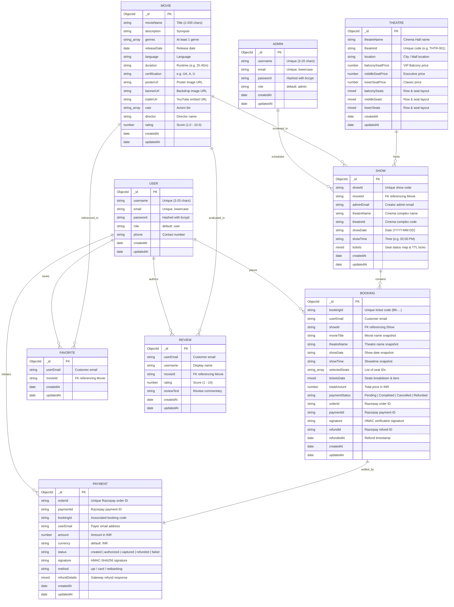

# 🗄️ iMovies - Entity Relationship (ER) Diagram

This document outlines the database schema architecture and entity relationships for the **iMovies - Movie Ticket Booking Platform**. The database is powered by **MongoDB** with schemas enforced through **Mongoose ODM**.

---

## 1. Visual Entity-Relationship Diagram



---

## 2. Detailed Schema & Field Specifications

### 2.1 User Entity (`users`)
- **Primary Identifier**: `_id` (`ObjectId`)
- **Key Fields**:
  - `username` (`String`): Unique handle between 3 and 20 characters.
  - `email` (`String`): Lowercase, validated with standard email RFC regex.
  - `password` (`String`): Hashed via bcrypt with salt rounds of 10.
  - `role` (`String`): Default `"user"`.
  - `phone` (`String`): Optional mobile number for WhatsApp notification fallback.

### 2.2 Admin Entity (`admins`)
- **Primary Identifier**: `_id` (`ObjectId`)
- **Key Fields**:
  - `username` (`String`): Unique administrator handle.
  - `email` (`String`): Unique administrator email address.
  - `password` (`String`): Securely hashed bcrypt credential.
  - `role` (`String`): Constant `"admin"` checked by `adminAuth.js` middleware.

### 2.3 Movie Entity (`movies`)
- **Primary Identifier**: `_id` (`ObjectId`)
- **Key Fields**:
  - `movieName` (`String`): Movie title with text index for fast catalog searches.
  - `description` (`String`): Synopsis and storyline.
  - `genres` (`[String]`): Custom validator enforcing at least 1 genre tag.
  - `releaseDate` (`Date`): Theatrical release date.
  - `language` (`String`): Primary audio language (e.g., English, Hindi).
  - `duration` (`String`): Runtime format (`"2h 45m"`).
  - `certification` (`String`): Censor board rating (`"U"`, `"UA"`, `"UA 16+"`, `"A"`).
  - `posterUrl` & `bannerUrl` (`String`): High-resolution promotional visual assets.
  - `rating` (`Number`): Average rating on a 1.0 to 10.0 scale.

### 2.4 Theatre Entity (`theatres`)
- **Primary Identifier**: `_id` (`ObjectId`)
- **Key Fields**:
  - `theatreName` (`String`): Cinema complex title (e.g., "PVR ICON: Gold Class").
  - `theatreId` (`String`): Unique business identifier (`"THTR-001"`).
  - `location` (`String`): Physical branch/mall location.
  - `balconySeatPrice`, `middleSeatPrice`, `lowerSeatPrice` (`Number`): Dynamic tier pricing in INR.
  - `balconySeats`, `middleSeats`, `lowerSeats` (`Mixed`): Seat matrices defining available rows, columns, and capacity.

### 2.5 Show Entity (`shows`)
- **Primary Identifier**: `_id` (`ObjectId`)
- **Key Fields**:
  - `showId` (`String`): Unique composite code formatted as:  
    `SHOW-<movieSuffix>-<theatreId>-<YYYY-MM-DD>-<time>`
  - `movieId` (`String`): Hex string referencing the targeted `Movie`.
  - `theatreId` & `theatreName` (`String`): Associated cinema hall.
  - `showDate` (`String`): Date stored as `"YYYY-MM-DD"`.
  - `showTime` (`String`): Showtime (e.g., `"10:30 AM"`, `"06:15 PM"`).
  - `tickets` (`Mixed`): Real-time dictionary tracking every seat code (e.g., `"A1"`, `"C5"`):
    ```json
    {
      "A1": {
        "status": "available",
        "tier": "balcony",
        "price": 450,
        "lockedBy": null,
        "lockExpiresAt": null
      }
    }
    ```

### 2.6 Booking Entity (`bookings`)
- **Primary Identifier**: `_id` (`ObjectId`)
- **Key Fields**:
  - `bookingId` (`String`): Human-readable reference code (`"BK-XXXXXX-XXX"`).
  - `userEmail` (`String`): Email of the customer who made the reservation.
  - `showId` (`String`): Referenced show code.
  - `selectedSeats` (`[String]`): Array of booked seat identifiers (`["A1", "A2"]`).
  - `totalAmount` (`Number`): Total price in INR.
  - `paymentStatus` (`String`): Enum `['Pending', 'Completed', 'Failed', 'Cancelled', 'Refunded']`.
  - `orderId`, `paymentId`, `signature` (`String`): Cryptographic transaction markers from Razorpay.
  - `refundId` (`String`): Gateway refund transaction ID when refunded.

### 2.7 Payment Entity (`payments`)
- **Primary Identifier**: `_id` (`ObjectId`)
- **Key Fields**:
  - `orderId` (`String`): Razorpay Order ID (`"order_xxxx"`).
  - `paymentId` (`String`): Captured payment ID (`"pay_xxxx"`).
  - `bookingId` (`String`): Reference to the booking entity.
  - `amount` (`Number`): Amount in paise/rupees.
  - `status` (`String`): Gateway lifecycle state (`'created'`, `'authorized'`, `'captured'`, `'refunded'`, `'failed'`).
  - `signature` (`String`): HMAC-SHA256 hash verified by backend.

### 2.8 Favorite Entity (`favorites`)
- **Primary Identifier**: `_id` (`ObjectId`)
- **Compound Index**: `{ userEmail: 1, movieId: 1 }` with `{ unique: true }` ensuring no duplicate watchlist entries.

### 2.9 Review Entity (`reviews`)
- **Primary Identifier**: `_id` (`ObjectId`)
- **Key Fields**:
  - `userEmail` (`String`): Submitter's email.
  - `movieId` (`String`): Target movie identifier.
  - `rating` (`Number`): Integer rating from 1 to 10.
  - `reviewText` (`String`): Written feedback.

---

## 3. Data Integrity & Concurrency Rules

1. **Temporary Seat Locking (TTL)**:
   - When seats are locked, `tickets[seatId].status` is set to `"locked"`, with `lockedBy = userEmail` and `lockExpiresAt = Date.now() + 10 * 60 * 1000`.
   - A minute-interval cron job (`cleanupService.js`) sweeps expired locks back to `"available"`.
2. **Refund Seat Freeing**:
   - When an administrator triggers a refund, the payment status changes to `"Refunded"`, and all seats in `selectedSeats` are instantly reset to `"available"`.
3. **Compound Uniqueness**:
   - Favorites prevent double-bookmarking via MongoDB compound indexes.
   - Show IDs and Booking IDs enforce strict single-occurrence integrity.
