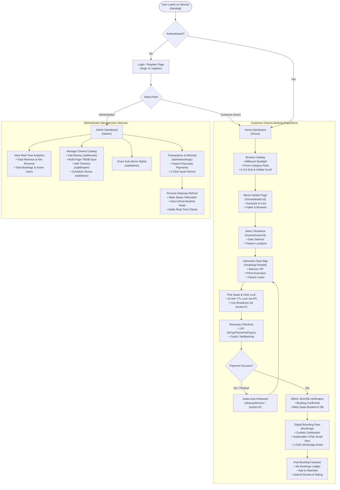

# 🗺️ iMovies - End-to-End User Flow & Journey

This document visualizes the complete user journey and state progression across the **iMovies - Movie Ticket Booking Platform**, covering both the **Customer Ticket Booking Experience** and the **Administrator Management Lifecycle**.

---

## 1. High-Level User Journey Diagram

---

## 2. Step-by-Step Customer Journey Lifecycle

### Stage 1: Discovery & Entry (`/landing`)
- **Experience**: The user lands on the cinematic Prime Video-themed hero billboard.
- **Actions**:
  - Browse public highlights and technology badges (Real-time seat locking, Razorpay UPI, WhatsApp ticket sharing).
  - Use 1-Click "Demo Sign-in" buttons or register a new customer account.

### Stage 2: Catalog Browsing & Exploration (`/home`)
- **Spotlight Hero**: Featured trending blockbuster with backdrop video trailer trigger.
- **Prime Video Content Rails**:
  - Horizontal scrolling category tracks: *Trending Now* (with `#1`, `#2` rank badges), *Now Showing in Theatres*, *Action & Adventure*, *Sci-Fi & Future Worlds*, *Drama & Comedy*.
- **Full Catalog Grid**:
  - Responsive 5-column layout (`grid-cols-2 sm:grid-cols-3 md:grid-cols-4 lg:grid-cols-5`).
  - Search across title, director, and actor names with 250ms debounce.
  - Multi-genre selector pills and audio language filter.
  - **Pagination / Infinite Scroll**: Seamless "Load More" button and `IntersectionObserver` scroll listener.

### Stage 3: Title Deep-Dive (`/moviedetails/:movieId`)
- **Content**: 4K backdrop art, certificate classification (`UA 16+`, `A`, `U`), duration, genres, release date, and full cast roster.
- **Interactions**:
  - Watch YouTube trailer in responsive lightbox modal.
  - Toggle movie to personal Watchlist (`/favoriteshows`).
  - Read community reviews or submit a star rating with feedback.
  - Primary CTA: **"Select Showtime & Book Seats"**.

### Stage 4: Showtime & Theatre Selection (`/movieshows/:movieId`)
- **Date Selector**: Horizontal date ribbon powered by `dayjs` showing available days for the next week.
- **Cinema Hall Listings**: Grouped by theatre location (e.g., PVR ICON Gold Class, IMAX Cinemax, INOX Megaplex).
- **Showtime Chips**: Interactive time chips displaying screening format (`4K Dolby Atmos`, `IMAX Laser`).

### Stage 5: Interactive Seat Selection & Real-Time Locking (`/seatslug/:showId`)
- **Curved Glowing Cinema Screen**: Electric cyan ambient lighting indicating screen direction.
- **Tiered Seating Grid**:
  - **VIP Balcony**: Royal Violet (`#8B5CF6`)
  - **Prime Executive**: Electric Cyan (`#00A8E1`)
  - **Classic Lower**: Teal Cyan (`#06B6D4`)
- **Seat States**:
  - *Available* (Selectable slate)
  - *Selected* (Vibrant emerald with checkmark)
  - *Locked* (Pulsing amber countdown indicating another user's active checkout)
  - *Booked* (Muted disabled slate)
- **Real-Time Lock Execution**:
  - Clicking "Lock Seats & Proceed" sends a `POST /api/bookings/lock-seats` request.
  - A **10-minute Time-To-Live (TTL)** lock is stamped in MongoDB.
  - Socket.IO broadcasts `seats_locked` across all connected clients to prevent duplicate reservations.

### Stage 6: Checkout & Payment (Razorpay Test Mode)
1. **Order Creation**: Frontend requests `POST /api/payment/create-order` with the locked seats and booking ID.
2. **Gateway Modal**: The official Razorpay Checkout v1 modal opens with simulated UPI (Google Pay, PhonePe, Paytm, QR code), Credit/Debit Cards, NetBanking, and Wallets.
3. **Cryptographic Verification**: On authorization, the client sends `razorpay_order_id`, `razorpay_payment_id`, and `razorpay_signature` to `POST /api/payment/verify`.
4. The backend computes an **HMAC-SHA256 digest** matching `order_id + "|" + payment_id` against `RAZORPAY_KEY_SECRET`.

### Stage 7: Digital Ticket Issuance & Sharing (`/bookings`)
- **Celebration**: Interactive confetti explosion rendered with `canvas-confetti`.
- **Digital Boarding Pass**: Perforated ticket with movie title, hall name, screening date/time, seat codes, total paid, and booking code.
- **Nodemailer Email Dispatch**: High-fidelity HTML receipt dispatched directly to the customer's registered email inbox.
- **1-Click WhatsApp Share**: Generates a pre-formatted message (`https://wa.me/?text=...`) for friends and family.

---

## 3. Administrator Lifecycle

```mermaid
sequenceDiagram
    autonumber
    actor Admin
    participant Frontend as Admin Portal (/admin)
    participant Server as Express REST API
    participant Razorpay as Razorpay API
    participant DB as MongoDB
    participant Socket as Socket.IO Bus

    Admin->>Frontend: Log in as Administrator
    Frontend->>Server: GET /api/admin/overview
    Server->>DB: Query aggregated revenue, bookings, shows
    DB-->>Server: Analytics data
    Server-->>Frontend: 200 OK (Stats JSON)

    rect rgb(15, 23, 42)
        note over Admin,DB: Cinema Catalog Management
        Admin->>Frontend: Trigger "Sync TMDB" or Add Movie
        Frontend->>Server: POST /api/movie/sync-tmdb
        Server->>DB: Upsert 26+ Movies & 520 Shows
        DB-->>Server: Catalog updated
        Server-->>Frontend: 200 OK (Sync Success)
    end

    rect rgb(19, 27, 46)
        note over Admin,Socket: Transaction & Refund Management
        Admin->>Frontend: Inspect Transactions Ledger
        Frontend->>Server: GET /api/admin/transactions
        Server->>DB: Fetch completed payments & bookings
        DB-->>Server: Transaction records
        Server-->>Frontend: Render transactions data table

        Admin->>Frontend: Click "Issue Refund" on Payment ID
        Frontend->>Server: POST /api/admin/refund/:paymentId
        Server->>Razorpay: Process refund via API
        Razorpay-->>Server: Refund approved (rfnd_xxxx)
        Server->>DB: Update Booking to 'Refunded' & Free Seats to 'available'
        Server->>Socket: Broadcast 'seats_released'
        Socket-->>Frontend: Live seat map updates for all users
        Server-->>Frontend: 200 OK (Refunded & Seats Freed)
    end
```

